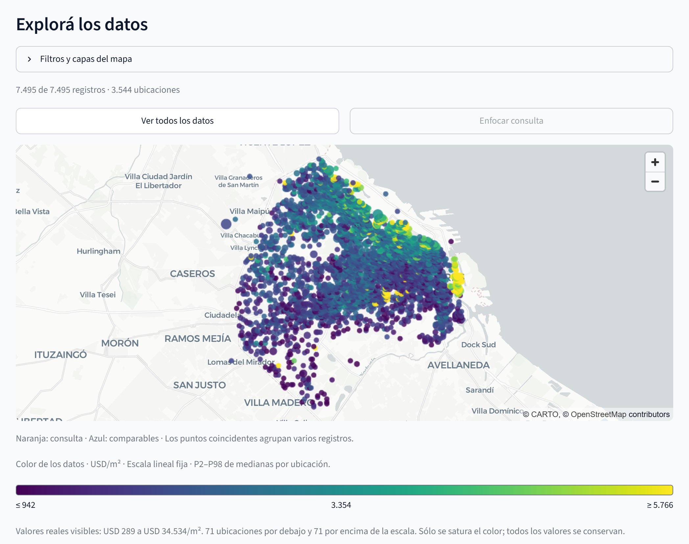
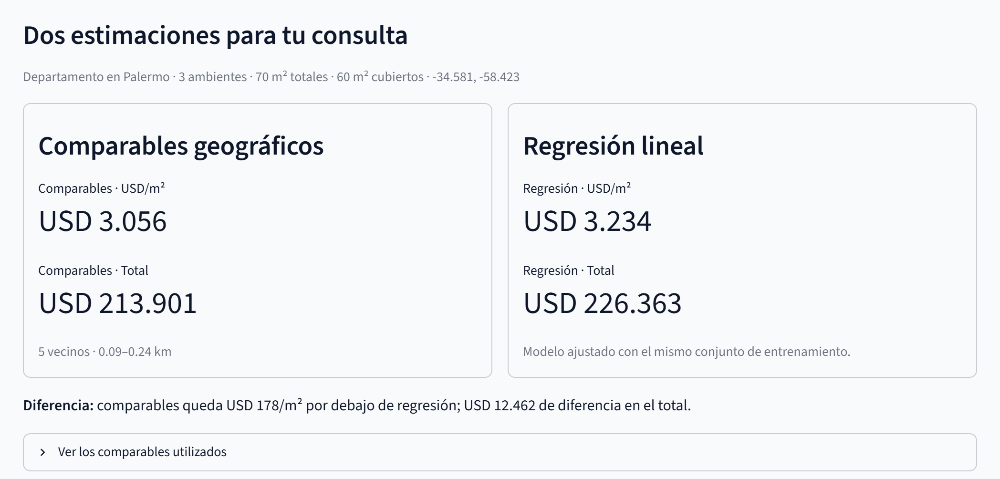

# Real estate price explorer

[Open the live app](https://real-estate-price-explorer.streamlit.app/) · [Source code](https://github.com/axel2307/real-estate-price-explorer)

A Streamlit portfolio project for exploring a property dataset and comparing **filtered geographic comparables** with **ordinary least squares regression** from one query. The interface is in Rioplatense Spanish under the title **Explorador y comparador inmobiliario**; implementation and documentation are in English.

The application bundles 7,495 records from a minimized, author-authorized dataset. Its short interface notice is **"Demo educativa con datos ficticios"**. The author declared the supplied data fictional; that declaration has not been independently verified. Results describe this demonstration dataset, not current valuations, closing prices, or measured market accuracy. See [data provenance](DATA_PROVENANCE.md) and [privacy](PRIVACY.md) for the source declaration and published fields.

## Screenshots



The public demo uses an author-declared fictional dataset. The map supports educational exploration, not current property valuation.

<details>
<summary>View the two model outputs</summary>



One submitted query produces two separate estimates. The app does not blend them into a third result.

</details>

## Run locally

Use Python 3.12 from this project directory:

```bash
python -m venv .venv
# macOS / Linux
source .venv/bin/activate
# Windows PowerShell instead: .\.venv\Scripts\Activate.ps1
python -m pip install -r requirements.txt
python -m streamlit run app.py
```

Runtime dependencies are pinned, with transitive versions recorded in `constraints.txt`. The app requires no secret, API key, geocoder, or external property-data service. The map loads its basemap over the network. This version uses only `data/demo.csv` and has no upload control or environment flag to enable uploads. A missing or invalid bundled dataset stops the app; there is no generated-data fallback.

## One query, two estimates

Enter a property type, neighborhood, whole number of rooms, total and covered areas, and an approximate location. Submit once to get each supported method's USD/m² and implied total. The total is the unit estimate multiplied by the entered total area, not a second fitted target. When both methods respond, the app shows their difference; it does not average them into a third estimate or automatically choose a winner.

| Input | Geographic comparables | Linear regression |
| --- | --- | --- |
| Property type | Exact candidate filter | Categorical feature |
| Rooms | Candidate tolerance | Numeric feature |
| Total area | Relative candidate tolerance | Numeric feature |
| Covered / total area | Candidate tolerance | Numeric feature |
| Latitude and longitude | Great-circle distance and search radius | Not model features |
| Neighborhood | Does not restrict neighbors | Categorical feature |
| Neighbor count, tolerances, radius | Search settings | No effect |

Covered ratio is calculated from the two areas. Bathrooms, amenities, condition, floor and other absent features are not inferred. A neighborhood reference location is calculated from training examples; it is an editable starting point, not a verified neighborhood center or a geocoded address.

Results belong to the last submitted query. Edits remain pending until the next submission, and exploring the map does not refit either method. Numeric property fields allow a typed value to reach server validation: zero or negative areas, invalid room counts, out-of-bounds coordinates, and covered area exceeding total area produce an error when submitted. An invalid submission clears the previous prediction and query marker instead of presenting a stale result. The evaluation retains the settings from the last valid submission. These controls do not relax either model's support limits. A method's lack of support does not prevent the other method from responding.

### Geographic comparables

The model retains training rows of the same property type, filters by rooms, relative total area and covered ratio, then orders the survivors by Haversine distance. It averages the USD/m² of up to `k` nearest rows within the radius. Default settings are `k=5`, radius 5 km, room tolerance 1, area tolerance 35%, and covered-ratio tolerance 0.25. The interface keeps these adjustments in a collapsed section.

At least three comparables are required. With fewer, their locations can still be shown, but no price is returned. Filters are never silently relaxed. Ties are resolved reproducibly in training-row order. The observed range of selected neighbor prices is descriptive, not a calibrated uncertainty interval.

This is **filtered geographic KNN**, with distance measured only in geographic space. A multivariable KNN would combine features in a different distance, requiring choices about scaling and weights. That model is not implemented here.

### Linear regression

The target is `price_usd / area_total`. The fit uses `numpy.linalg.lstsq`, one intercept, training-only numeric means and scales, and one omitted reference level for each categorical feature. Predictions are assembled by learned feature names, so input column order cannot change their meaning. The fit does not invert `X.T @ X`.

The model rejects unseen categories, unseen property-type/neighborhood combinations, numeric values outside their individual training ranges, and nonpositive or nonfinite predictions. It does not silently clip predictions or extrapolate. A `1e100` magnitude bound protects numerical operations; it is not a market-price threshold. Per-feature range checks do not establish joint statistical support for every possible combination. Rank and condition diagnostics help identify an unstable design; no confidence or prediction interval is inferred from training residuals.

## Explore the map

The map starts with all 7,495 published records. They occupy 3,544 distinct rounded coordinate pairs. Only coincident points are grouped: a marker's count represents its records, which remain available through a selectable detail view. Sharing rounded coordinates does not establish that records describe the same property. No artificial coordinate jitter is added.

The layers distinguish dataset points, the submitted query, and its selected training neighbors. Dataset filters for property type, neighborhood and price, plus a color choice of total USD or USD/m², change the visual exploration only. They do not change model training, neighbor selection, or evaluation. The price filter uses the selected color metric's units. Changing units resets the price range so a total-price limit is never silently reused as USD/m².

Marker color describes the median of visible records at that location. The **Viridis** palette uses a linear scale for USD/m² and a logarithmic scale for total USD. Its reference limits are the 2nd and 98th percentiles of **location medians across the full public dataset**, not percentiles of individual rows. These limits stay fixed when map filters change. The legend marks the ends with **≤** and **≥**: values beyond those limits receive the endpoint colors, while their records and original numeric values remain accessible. Color saturation does not remove records, cap model targets, transform model prices, or change evaluation.

Layer controls and explicit overview/query-focus actions make the map usable without relying on hover; record selection also has a control outside the canvas. Display record numbers are assigned within the public dataset and are not identifiers from the source file. On narrow screens, inputs and estimate cards stack vertically.

Coordinates are rounded to three decimals, roughly a 100-meter grid at this latitude. Distances and positions are approximate. The accepted bounds are latitude `[-34.71, -34.52]` and longitude `[-58.54, -58.32]`: a plausibility rectangle, not the administrative CABA boundary. The neighborhood allowlist includes common real-estate subareas. A coordinate does not prove membership in the selected neighborhood.

The browser can explore the entire published dataset, including held-out records. The predictive methods still use only training rows. Looking at held-out outcomes to tune settings repeatedly can bias evaluation; this is an interactive educational comparison, not an untouched final benchmark.

## Fair evaluation

Both methods share the same validated data and the same fixed spatial split. With the bundled projection, seed `42` holds out 38 of 190 cells of 0.01 degrees: **6,540 training rows and 955 evaluation rows**. Whole cells are sampled without inspecting target values; the row fraction therefore differs from 20%.

The comparison evaluates **all 955 held-out cases** for both methods, using comparable settings from the last valid submission (or the defaults before the first one). Pending edits and invalid submissions do not change those evaluation settings. It reports each method's coverage over those same 955 cases, then computes mean absolute error, median absolute error and the training-median baseline on **the intersection of cases supported by both methods**. The shared-case count is shown. Empty intersections produce no invented errors. Old app metrics based on different samples or supported subsets are not reused.

Interactive predictions keep the same training-only models. Categories, numeric scaling, ranges and coefficients are learned from training data alone; held-out targets are never added to the neighbor pool. Metrics are computed from the bundled projection at runtime and are not hard-coded in this README.

A structured-source audit reproduced the initial projection byte for byte and found no numerical contradictions in the checked price, currency and unit-price fields. That consistency does not establish that every amount represents a total property price. A focused review identified one installment amount; that record was excluded with the author's authorization. No total price was inferred or imputed. Ambiguous records, including one unresolved currency context, remain provisionally retained without automatic conversion. No private source text or identifiers are published.

Extreme prices alone are not evidence of a data error, and model difficulty is not a reason to remove a record. The single exclusion is based on evidence about the target's meaning, independently of prediction errors; all other retained values are unchanged. No price cutoff is chosen from held-out errors. The map's display percentiles are separate from model preparation and scoring. See [data provenance](DATA_PROVENANCE.md) for the reproducible correction and remaining target-quality limitations.

Location/feature duplicates are removed before splitting, without price in the duplicate key. This can merge distinct records with matching recorded features and can miss repeats whose features changed. Spatial cells reduce leakage but have no distance buffer: records across a cell boundary can remain close. Reliable observation dates are absent, so no temporal forecasting performance is claimed. Complete-case filtering and sparse categories also limit interpretation.

## Tests and project structure

```bash
python -m pip install -r requirements-dev.txt
python -m pip check
python -m pytest
```

CI is configured to run compilation and the test suite on Python 3.12 under Windows and Linux. The tests cover ingestion and spatial separation, geographic filters, named linear features and support rules, common-subset evaluation, map grouping, and query/result integration. Browser review additionally checks the rendered desktop and mobile experience; a passing unit test does not establish that a deployment is available.

```text
app.py                  Streamlit interface and session state
explorer.py             Shared query and comparison helpers
comparables.py          Filtered geographic neighbors
linear.py               Named, scaled OLS fit and support checks
evaluation.py           Coverage and errors on common held-out cases
map_view_v1.py           Visual filters, coincident points and map layers
data.py                 Validation, public projection loading, spatial split
data/demo.csv           Authorized eight-field demonstration projection
docs/images/            Screenshots captured from the public demo
scripts/prepare_demo.py Local, explicit projection preparation
tests/                  Automated behavioral and numerical checks
```

The raw-file parser and synthetic generator remain as preparation/test utilities; the application does not expose them to visitors. See [deployment](DEPLOYMENT.md) for the separate-repository release and rollback procedure.
